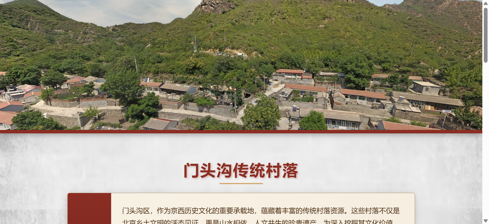

# Mentougou Village Culture Site



门头沟传统村落文化展示网站，使用原生 HTML/CSS/JavaScript 构建。

## 页面

- 首页：村落总览、滚动头图和导航
- 地图页：村落位置和入口
- 村落详情页：爨底下、灵水、琉璃渠、马栏、碣石、沿河城等
- 马栏村专题页：革命旧址、龙王观音禅寺、历史建筑
- 琉璃渠专题页

## 技术栈

- HTML5
- CSS3
- JavaScript
- 响应式布局
- GitHub Pages 静态部署

## 运行

直接双击 `index.html`，或启动静态服务器：

```powershell
python -m http.server 8080
```

打开 <http://localhost:8080>。

## 部署到 GitHub Pages

```text
Settings -> Pages -> Build and deployment -> Deploy from a branch
Branch: main
Folder: / (root)
```

首页入口是 `index.html`。

## 项目结构

```text
village-culture-site/
├─ index.html
├─ map.html
├─ village/
│  ├─ cuandixia.html
│  ├─ lingshui.html
│  ├─ liuliqu.html
│  ├─ malan.html
│  └─ ...
└─ README.md
```

## 素材说明

- 原项目中的需求截图、设计稿和重复版本未上传。
- 页面图片已缩放到最大 1600 px 并重新压缩，原始 244 MB 素材集不在仓库中。
- 村落照片可能来自公开资料或采集素材，公开再分发前应确认每张图片的来源和授权。
- 这个仓库当前适合作为 private 作品集；确认图片授权后再切换为 public。

## 已修复

- 为 `index.html` 保留根入口
- 移除未完成且引用缺失图片的 `后续.html`
- 将滚动横幅 PNG 转为体积更小的 JPG，并同步更新页面引用

